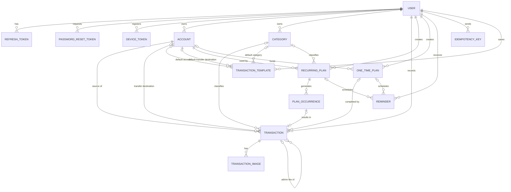

# PRD Financare: Entity Relationship Diagram (ERD)

Relational data model (PostgreSQL recommended). It extends the entity list in the main PRD with the additions required by [`user_flow.md`](./user_flow.md) and [`endpoint.md`](./endpoint.md).

## 1. Overview



## 2. ID Format

Every primary key is a human-readable string made of an entity prefix and a zero-padded sequence number, for example `TRANS001`.

| Entity | Prefix | Example |
|---|---|---|
| User | `USR` | `USR001` |
| Account | `ACC` | `ACC001` |
| Category | `CAT` | `CAT001` |
| Transaction | `TRANS` | `TRANS001` |
| TransactionImage | `IMG` | `IMG001` |
| RecurringPlan | `RPLAN` | `RPLAN001` |
| PlanOccurrence | `OCC` | `OCC001` |
| OneTimePlan | `OPLAN` | `OPLAN001` |
| Reminder | `RMD` | `RMD001` |
| RefreshToken | `RTK` | `RTK001` |
| PasswordResetToken | `PRT` | `PRT001` |
| DeviceToken | `DVC` | `DVC001` |
| TransactionTemplate | `TPL` | `TPL001` |

Rules:
- Type: `varchar(20)`. Pattern: `^[A-Z]+[0-9]{3,}$`. Minimum 3 digits; the number simply grows past 999 (`TRANS1000`), it is not capped.
- The number comes from one PostgreSQL sequence per table (for example `transaction_id_seq`). The ID is built in the database as `'TRANS' || lpad(nextval('transaction_id_seq')::text, 3, '0')`, so concurrent inserts never collide. Gaps are allowed (failed inserts and rollbacks consume numbers).
- The sequence is **global per table**, not per user. IDs are unique across all users.
- IDs are never reused or edited after creation.
- Sequential IDs are guessable. Safety relies on every query being scoped by `user_id` (another user's ID returns `404`), never on the ID being secret.
- `IdempotencyKey.key` is the exception: it is the client-generated UUID from the `Idempotency-Key` header, stored as `varchar(64)`.

## 3. Entity Diagram with Attributes

```mermaid
erDiagram
    USER {
        string id PK
        string name
        string email UK
        string password_hash
        string timezone
        boolean hide_balance
        time notif_send_time
        time quiet_hours_start
        time quiet_hours_end
        boolean push_enabled
        boolean email_fallback
        timestamptz deleted_at
    }

    REFRESH_TOKEN {
        string id PK
        string user_id FK
        string family_id
        string token_hash UK
        string device_info
        timestamptz expires_at
        timestamptz revoked_at
        string replaced_by FK
    }

    PASSWORD_RESET_TOKEN {
        string id PK
        string user_id FK
        string token_hash UK
        timestamptz expires_at
        timestamptz used_at
    }

    DEVICE_TOKEN {
        string id PK
        string user_id FK
        string token UK
        enum platform
        timestamptz last_seen_at
    }

    ACCOUNT {
        string id PK
        string user_id FK
        string name
        enum type
        string institution
        bigint initial_balance
        string last4
        string color
        string icon
        boolean include_in_total
        enum status
    }

    CATEGORY {
        string id PK
        string user_id FK
        string name
        enum type
        string icon
        boolean is_default
        boolean is_fallback
    }

    TRANSACTION {
        string id PK
        string user_id FK
        string account_id FK
        string to_account_id FK
        string category_id FK
        string parent_transaction_id FK
        string recurring_plan_id FK
        string one_time_plan_id FK
        enum type
        string name
        bigint amount
        timestamptz date
        string location
        text note
        text_array tags
        enum source
        timestamptz deleted_at
    }

    TRANSACTION_IMAGE {
        string id PK
        string transaction_id FK
        string public_id UK
        string mime_type
        int size
        smallint position
    }

    RECURRING_PLAN {
        string id PK
        string user_id FK
        string account_id FK
        string category_id FK
        string name
        enum type
        bigint amount
        enum frequency
        date start_date
        date end_date
        int_array reminder_offsets
        boolean auto_record
        date next_due_date
        enum status
    }

    PLAN_OCCURRENCE {
        string id PK
        string recurring_plan_id FK
        date due_date
        enum outcome
        string transaction_id FK
        timestamptz resolved_at
    }

    ONE_TIME_PLAN {
        string id PK
        string user_id FK
        string source_account_id FK
        string name
        date date
        bigint target_amount
        string location
        text note
        int_array reminder_offsets
        enum status
    }

    REMINDER {
        string id PK
        string user_id FK
        string recurring_plan_id FK
        string one_time_plan_id FK
        date due_date
        timestamptz scheduled_at
        timestamptz sent_at
        enum channel
        enum status
        int attempts
    }

    TRANSACTION_TEMPLATE {
        string id PK
        string user_id FK
        string name
        enum type
        string transaction_name
        bigint amount
        string account_id FK
        string to_account_id FK
        string category_id FK
        string location
        text note
        text_array tags
        int use_count
        timestamptz last_used_at
    }

    IDEMPOTENCY_KEY {
        string key PK
        string user_id FK
        string route
        jsonb response
        timestamptz created_at
    }
```



## 4. Data Dictionary

Conventions: money is `bigint` in IDR with no decimals; timestamps are `timestamptz` stored in UTC; "Null" = `Y` means the column is optional. Every table also has `created_at timestamptz NOT NULL DEFAULT now()` and `updated_at timestamptz NOT NULL DEFAULT now()` unless stated. Monetary limits use `MAX_AMOUNT = 999,999,999,999` (just under Rp1 trillion).

### 4.1 `user`

| Column | Type | Null | Default | Min / Max | Notes |
|---|---|---|---|---|---|
| `id` | varchar(20) | N | sequence | `USR` + 3+ digits | PK |
| `name` | varchar(100) | N | | 1 – 100 chars | Trimmed |
| `email` | varchar(254) | N | | Valid email, max 254 | Stored lowercase; unique on `lower(email)` |
| `password_hash` | varchar(255) | N | | | argon2id (or bcrypt) hash. Raw password: 8 – 72 chars at the API |
| `timezone` | varchar(64) | N | `Asia/Jakarta` | IANA name | Used for reminders and "today" |
| `hide_balance` | boolean | N | `false` | | Hide-balance preference |
| `notif_send_time` | time | N | `08:00` | | Local time of daily reminder digest |
| `quiet_hours_start` | time | Y | null | | Both quiet-hour columns are set together or both null |
| `quiet_hours_end` | time | Y | null | | |
| `push_enabled` | boolean | N | `true` | | |
| `email_fallback` | boolean | N | `false` | | Email is used when push is disabled or has no device token |
| `deleted_at` | timestamptz | Y | null | | Set while account deletion runs in the background |

### 4.2 `refresh_token`

| Column | Type | Null | Default | Min / Max | Notes |
|---|---|---|---|---|---|
| `id` | varchar(20) | N | sequence | `RTK` + 3+ digits | PK |
| `user_id` | varchar(20) | N | | | FK → `user.id`, `ON DELETE CASCADE` |
| `family_id` | varchar(36) | N | | | Shared by all tokens of one login session (random UUID) |
| `token_hash` | char(64) | N | | | SHA-256 hex of the opaque token; unique. The raw token is never stored |
| `device_info` | varchar(255) | Y | null | ≤ 255 chars | Device name / platform |
| `expires_at` | timestamptz | N | now + 30 days | | |
| `revoked_at` | timestamptz | Y | null | | Set on rotation, logout, or reuse detection |
| `replaced_by` | varchar(20) | Y | null | | FK → `refresh_token.id`; next token in the rotation chain |

### 4.3 `password_reset_token`

| Column | Type | Null | Default | Min / Max | Notes |
|---|---|---|---|---|---|
| `id` | varchar(20) | N | sequence | `PRT` + 3+ digits | PK |
| `user_id` | varchar(20) | N | | | FK → `user.id`, `ON DELETE CASCADE` |
| `token_hash` | char(64) | N | | | SHA-256 hex; unique |
| `expires_at` | timestamptz | N | now + 30 minutes | | |
| `used_at` | timestamptz | Y | null | | Single use |

### 4.4 `device_token`

| Column | Type | Null | Default | Min / Max | Notes |
|---|---|---|---|---|---|
| `id` | varchar(20) | N | sequence | `DVC` + 3+ digits | PK |
| `user_id` | varchar(20) | N | | | FK → `user.id`, `ON DELETE CASCADE` |
| `token` | varchar(512) | N | | 1 – 512 chars | FCM / APNs token; unique |
| `platform` | enum | N | | `ANDROID`, `IOS` | |
| `last_seen_at` | timestamptz | N | now | | Stale tokens are removed when the push service rejects them |

### 4.5 `account`

| Column | Type | Null | Default | Min / Max | Notes |
|---|---|---|---|---|---|
| `id` | varchar(20) | N | sequence | `ACC` + 3+ digits | PK |
| `user_id` | varchar(20) | N | | | FK → `user.id`, `ON DELETE CASCADE` |
| `name` | varchar(50) | N | | 1 – 50 chars | e.g. "BCA Salary" |
| `type` | enum | N | | `BANK`, `EWALLET`, `CASH` | |
| `institution` | varchar(50) | Y | null | ≤ 50 chars | Must be null for `CASH` |
| `initial_balance` | bigint | N | `0` | −MAX_AMOUNT … MAX_AMOUNT | Integer IDR; may be negative |
| `last4` | char(4) | Y | null | 4 digits (`^[0-9]{4}$`) | Only a distinguishing hint; the full number is never stored |
| `color` | varchar(9) | Y | null | `#RRGGBB` or `#RRGGBBAA` | |
| `icon` | varchar(50) | Y | null | ≤ 50 chars | Icon key |
| `include_in_total` | boolean | N | `true` | | |
| `status` | enum | N | `ACTIVE` | `ACTIVE`, `ARCHIVED` | |

Unique: `(user_id, lower(name))` among non-archived accounts is recommended to avoid duplicates (optional).

### 4.6 `category`

| Column | Type | Null | Default | Min / Max | Notes |
|---|---|---|---|---|---|
| `id` | varchar(20) | N | sequence | `CAT` + 3+ digits | PK |
| `user_id` | varchar(20) | N | | | FK → `user.id`, `ON DELETE CASCADE` |
| `name` | varchar(50) | N | | 1 – 50 chars | |
| `type` | enum | N | | `INCOME`, `OUTCOME` | |
| `icon` | varchar(50) | Y | null | ≤ 50 chars | |
| `is_default` | boolean | N | `false` | | Seeded at register |
| `is_fallback` | boolean | N | `false` | | `true` only for "Other" (one per type per user); cannot be renamed or deleted |

Seeded outcome categories: Food, Transport, Bills, Shopping, Entertainment, Health, Admin Fee, Other. Seeded income categories: Salary, Other.

### 4.7 `transaction`

| Column | Type | Null | Default | Min / Max | Notes |
|---|---|---|---|---|---|
| `id` | varchar(20) | N | sequence | `TRANS` + 3+ digits | PK |
| `user_id` | varchar(20) | N | | | FK → `user.id`, `ON DELETE CASCADE` |
| `account_id` | varchar(20) | N | | | FK → `account.id`, `ON DELETE RESTRICT`. Source account for transfers |
| `to_account_id` | varchar(20) | Y | null | | FK → `account.id`. Required for `TRANSFER`, null otherwise |
| `category_id` | varchar(20) | Y | null | | FK → `category.id`, `ON DELETE SET NULL`. Must be null for `TRANSFER` |
| `parent_transaction_id` | varchar(20) | Y | null | | FK → `transaction.id`, `ON DELETE CASCADE`. Set on the admin-fee outcome of a transfer |
| `recurring_plan_id` | varchar(20) | Y | null | | FK → `recurring_plan.id`, `ON DELETE SET NULL` |
| `one_time_plan_id` | varchar(20) | Y | null | | FK → `one_time_plan.id`, `ON DELETE SET NULL` |
| `type` | enum | N | | `INCOME`, `OUTCOME`, `TRANSFER` | |
| `name` | varchar(100) | N | | 1 – 100 chars | |
| `amount` | bigint | N | | 1 … MAX_AMOUNT | Integer IDR, always positive |
| `date` | timestamptz | N | now | ≤ now | Future dates are rejected |
| `location` | varchar(255) | Y | null | ≤ 255 chars | |
| `note` | text | Y | null | ≤ 1,000 chars | Limit enforced by the API |
| `tags` | text[] | N | `{}` | ≤ 10 tags, each 1 – 30 chars | Lowercased and de-duplicated |
| `source` | enum | N | `MANUAL` | `MANUAL`, `AUTO` | `AUTO` for auto-recorded recurring plans |
| `deleted_at` | timestamptz | Y | null | | Soft delete; purged permanently after 30 days |

### 4.8 `transaction_image`

| Column | Type | Null | Default | Min / Max | Notes |
|---|---|---|---|---|---|
| `id` | varchar(20) | N | sequence | `IMG` + 3+ digits | PK |
| `transaction_id` | varchar(20) | N | | | FK → `transaction.id`, `ON DELETE CASCADE` |
| `public_id` | varchar(255) | N | | 1 – 255 chars | Cloudinary `public_id`; unique |
| `mime_type` | varchar(20) | N | | `image/jpeg`, `image/png`, `image/heic` | |
| `size` | int | N | | 1 … 5,242,880 bytes (5 MB) | |
| `position` | smallint | N | | 0 … 4 | Display order; at most 5 images per transaction |

### 4.9 `recurring_plan`

| Column | Type | Null | Default | Min / Max | Notes |
|---|---|---|---|---|---|
| `id` | varchar(20) | N | sequence | `RPLAN` + 3+ digits | PK |
| `user_id` | varchar(20) | N | | | FK → `user.id`, `ON DELETE CASCADE` |
| `account_id` | varchar(20) | N | | | FK → `account.id`, `ON DELETE RESTRICT` |
| `category_id` | varchar(20) | Y | null | | FK → `category.id`, `ON DELETE SET NULL` |
| `name` | varchar(100) | N | | 1 – 100 chars | |
| `type` | enum | N | | `INCOME`, `OUTCOME` | |
| `amount` | bigint | N | | 1 … MAX_AMOUNT | Estimated amount per period |
| `frequency` | enum | N | | `DAILY`, `WEEKLY`, `MONTHLY`, `YEARLY` | |
| `start_date` | date | N | | ≥ creation date | Anchor for the day of month (29–31 rolls to month end) |
| `end_date` | date | Y | null | > `start_date` | Null means no end |
| `reminder_offsets` | int[] | N | | 1 – 4 distinct values from {0, 1, 3, 7} | Days before the due date |
| `auto_record` | boolean | N | `false` | | |
| `next_due_date` | date | N | `start_date` | | Advances after confirm / skip / auto-record |
| `status` | enum | N | `ACTIVE` | `ACTIVE`, `PAUSED`, `ENDED` | `ENDED` once past `end_date` |

### 4.10 `plan_occurrence`

| Column | Type | Null | Default | Min / Max | Notes |
|---|---|---|---|---|---|
| `id` | varchar(20) | N | sequence | `OCC` + 3+ digits | PK |
| `recurring_plan_id` | varchar(20) | N | | | FK → `recurring_plan.id`, `ON DELETE CASCADE` |
| `due_date` | date | N | | | Unique together with `recurring_plan_id` |
| `outcome` | enum | N | | `CONFIRMED`, `SKIPPED`, `AUTO_RECORDED` | |
| `transaction_id` | varchar(20) | Y | null | | FK → `transaction.id`, `ON DELETE SET NULL`. Null when `SKIPPED` |
| `resolved_at` | timestamptz | N | now | | |

### 4.11 `one_time_plan`

| Column | Type | Null | Default | Min / Max | Notes |
|---|---|---|---|---|---|
| `id` | varchar(20) | N | sequence | `OPLAN` + 3+ digits | PK |
| `user_id` | varchar(20) | N | | | FK → `user.id`, `ON DELETE CASCADE` |
| `source_account_id` | varchar(20) | Y | null | | FK → `account.id`, `ON DELETE SET NULL`. Null = check funding against total balance |
| `name` | varchar(100) | N | | 1 – 100 chars | |
| `date` | date | N | | ≥ creation date | Execution date |
| `target_amount` | bigint | N | | 1 … MAX_AMOUNT | Funds to prepare |
| `location` | varchar(255) | Y | null | ≤ 255 chars | |
| `note` | text | Y | null | ≤ 1,000 chars | |
| `reminder_offsets` | int[] | N | | 1 – 4 distinct values from {1, 3, 7, 14} | |
| `status` | enum | N | `PLANNED` | `PLANNED`, `DONE`, `MISSED`, `CANCELLED` | |

### 4.12 `reminder`

| Column | Type | Null | Default | Min / Max | Notes |
|---|---|---|---|---|---|
| `id` | varchar(20) | N | sequence | `RMD` + 3+ digits | PK |
| `user_id` | varchar(20) | N | | | FK → `user.id`, `ON DELETE CASCADE` |
| `recurring_plan_id` | varchar(20) | Y | null | | FK → `recurring_plan.id`, `ON DELETE CASCADE` |
| `one_time_plan_id` | varchar(20) | Y | null | | FK → `one_time_plan.id`, `ON DELETE CASCADE`. Exactly one of the two plan columns is set |
| `due_date` | date | N | | | The occurrence or plan date being reminded |
| `scheduled_at` | timestamptz | N | | | Computed from the user's send time and timezone |
| `sent_at` | timestamptz | Y | null | | |
| `channel` | enum | N | `PUSH` | `PUSH`, `EMAIL` | |
| `status` | enum | N | `SCHEDULED` | `SCHEDULED`, `SENT`, `ACTED`, `SNOOZED`, `SKIPPED`, `FAILED` | |
| `attempts` | int | N | `0` | 0 … 5 | Sending retries; `FAILED` after the limit |

### 4.13 `idempotency_key`

| Column | Type | Null | Default | Min / Max | Notes |
|---|---|---|---|---|---|
| `key` | varchar(64) | N | | 1 – 64 chars | Client UUID from the `Idempotency-Key` header. PK together with `user_id` |
| `user_id` | varchar(20) | N | | | FK → `user.id`, `ON DELETE CASCADE` |
| `route` | varchar(100) | N | | ≤ 100 chars | e.g. `POST /transactions` |
| `response` | jsonb | N | | | Stored response replayed on retry |
| `created_at` | timestamptz | N | now | | Purged after 24 hours. This table has no `updated_at` |

### 4.14 `transaction_template`

A saved set of transaction fields the user can reuse. Receipt images are **not** part of a template.

| Column | Type | Null | Default | Min / Max | Notes |
|---|---|---|---|---|---|
| `id` | varchar(20) | N | sequence | `TPL` + 3+ digits | PK |
| `user_id` | varchar(20) | N | | | FK → `user.id`, `ON DELETE CASCADE` |
| `name` | varchar(50) | N | | 1 – 50 chars | Template name, e.g. "Office lunch". Unique per user on `lower(name)` |
| `type` | enum | N | | `INCOME`, `OUTCOME`, `TRANSFER` | |
| `transaction_name` | varchar(100) | N | | 1 – 100 chars | Default name of the transaction created from the template |
| `amount` | bigint | Y | null | 1 … MAX_AMOUNT | Null means the amount is entered every time the template is used |
| `account_id` | varchar(20) | Y | null | | FK → `account.id`, `ON DELETE SET NULL`. Cleared when the account is archived or deleted. Source account for transfers |
| `to_account_id` | varchar(20) | Y | null | | FK → `account.id`, `ON DELETE SET NULL`. Only for `TRANSFER`; cleared like `account_id` |
| `category_id` | varchar(20) | Y | null | | FK → `category.id`, `ON DELETE SET NULL`. Must be null for `TRANSFER` |
| `location` | varchar(255) | Y | null | ≤ 255 chars | |
| `note` | text | Y | null | ≤ 1,000 chars | Limit enforced by the API |
| `tags` | text[] | N | `{}` | ≤ 10 tags, each 1 – 30 chars | Lowercased and de-duplicated |
| `use_count` | int | N | `0` | ≥ 0 | Incremented each time a transaction is created from the template; used to sort |
| `last_used_at` | timestamptz | Y | null | | Tie-breaker for sorting |

There is no limit on the number of templates per user (MVP). The transaction created from a template does not store a reference back to it.

## 5. Relationships

| Relationship | Cardinality | Notes |
|---|---|---|
| User → Account | 1 : N | Every account belongs to exactly one user |
| User → Category | 1 : N | Default categories are copied per user at register |
| Account → Transaction (`account_id`) | 1 : N | Required. For a transfer this is the source account |
| Account → Transaction (`to_account_id`) | 1 : N (optional) | Only for `TRANSFER` |
| Category → Transaction | 1 : N (optional) | Not used for transfers. On category delete, transactions move to the fallback category |
| Transaction → TransactionImage | 1 : N | Maximum 5 per transaction |
| Transaction → Transaction (`parent_transaction_id`) | 1 : N (optional) | Admin fee outcome linked to its transfer |
| Transaction → plan | N : 0..1 | At most one of `recurring_plan_id` or `one_time_plan_id` is set |
| RecurringPlan → PlanOccurrence | 1 : N | One row per resolved due date |
| PlanOccurrence → Transaction | 1 : 0..1 | Null when the occurrence was skipped |
| Account → RecurringPlan | 1 : N | |
| Account → OneTimePlan (`source_account_id`) | 1 : N (optional) | Null means funding is checked against total balance |
| Plan → Reminder | 1 : N | A reminder belongs to exactly one plan (recurring or one-time) |
| User → RefreshToken / DeviceToken / PasswordResetToken / IdempotencyKey | 1 : N | |
| User → TransactionTemplate | 1 : N | |
| Account → TransactionTemplate (`account_id`, `to_account_id`) | 1 : N (optional) | Cleared (set to null) when the account is archived or deleted |
| Category → TransactionTemplate | 1 : N (optional) | Re-pointed or cleared when the category is deleted |

## 6. Constraints

**Checks**
| Table | Constraint |
|---|---|
| all tables | `id ~ '^PREFIX[0-9]{3,}$'` for the table's own prefix |
| `transaction` | `amount > 0 AND amount <= 999999999999` |
| `transaction` | `type = 'TRANSFER'` ⇔ `to_account_id IS NOT NULL`; `account_id <> to_account_id` |
| `transaction` | `type = 'TRANSFER'` ⇒ `category_id IS NULL` |
| `transaction` | `NOT (recurring_plan_id IS NOT NULL AND one_time_plan_id IS NOT NULL)` |
| `transaction` | `parent_transaction_id` is only allowed with `type = 'OUTCOME'`, and the parent must be a `TRANSFER` |
| `transaction` | `cardinality(tags) <= 10` |
| `account` | `last4 ~ '^[0-9]{4}$'` when not null |
| `account` | `type = 'CASH'` ⇒ `institution IS NULL` |
| `recurring_plan` | `amount > 0`; `end_date IS NULL OR end_date > start_date`; `reminder_offsets <@ {0,1,3,7}`; `cardinality(reminder_offsets) BETWEEN 1 AND 4` |
| `one_time_plan` | `target_amount > 0`; `reminder_offsets <@ {1,3,7,14}`; `cardinality(reminder_offsets) BETWEEN 1 AND 4` |
| `reminder` | Exactly one of `recurring_plan_id` and `one_time_plan_id` is not null; `attempts BETWEEN 0 AND 5` |
| `transaction_image` | `position BETWEEN 0 AND 4`; `size BETWEEN 1 AND 5242880` |
| `transaction_template` | `amount IS NULL OR (amount > 0 AND amount <= 999999999999)` |
| `transaction_template` | `type <> 'TRANSFER'` ⇒ `to_account_id IS NULL`; `type = 'TRANSFER'` ⇒ `category_id IS NULL`; `account_id <> to_account_id` when both are set |
| `transaction_template` | `cardinality(tags) <= 10` |
| `user` | `(quiet_hours_start IS NULL) = (quiet_hours_end IS NULL)` |

**Unique**
| Table | Columns | Purpose |
|---|---|---|
| `user` | `lower(email)` | One account per email |
| `plan_occurrence` | `(recurring_plan_id, due_date)` | **Idempotent** confirm, skip, and auto-record. A second attempt for the same due date fails and returns the existing result |
| `category` | `(user_id, type, lower(name))` | No duplicate category names |
| `transaction_image` | `public_id` | One Cloudinary asset is attached once |
| `transaction_image` | `(transaction_id, position)` | Stable ordering |
| `refresh_token` | `token_hash` | |
| `password_reset_token` | `token_hash` | |
| `device_token` | `token` | Re-registering the same token updates the row |
| `idempotency_key` | `(user_id, key)` | |
| `transaction_template` | `(user_id, lower(name))` | No two templates with the same name per user |

**Application-level rules** (not expressible as simple checks)
- Maximum 5 images per transaction.
- `transaction.date` must not be later than now; future events are modeled as plans.
- Source and destination accounts must be `ACTIVE` when a transaction is created.
- A category's `type` must match the transaction's `type`.
- The fallback category ("Other") exists once per `type` per user and cannot be renamed or deleted.
- No limit on the number of plans per user (MVP).

## 7. Indexes

| Table | Index | Used for |
|---|---|---|
| `transaction` | `(user_id, date DESC) WHERE deleted_at IS NULL` | Transaction list, dashboard recent items |
| `transaction` | `(account_id, date DESC) WHERE deleted_at IS NULL` | Account balance and account history |
| `transaction` | `(to_account_id) WHERE to_account_id IS NOT NULL` | Incoming transfers |
| `transaction` | `(user_id, category_id, date)` | Outcome-by-category report |
| `transaction` | `(deleted_at) WHERE deleted_at IS NOT NULL` | Trash list and the 30-day purge job |
| `transaction` | GIN on `tags`; trigram on `name`, `note` | Search and tag filter |
| `recurring_plan` | `(status, next_due_date)` | Auto-record job |
| `one_time_plan` | `(status, date)` | Mark-missed job |
| `reminder` | `(status, scheduled_at)` | Sender job (polls every minute) |
| `reminder` | `(user_id, status)` | "Action needed" list |
| `refresh_token` | `(user_id)`, `(family_id)` | Revoke all or revoke a session family |
| `refresh_token` | `(expires_at)` | Cleanup job |
| `transaction_template` | `(user_id, use_count DESC, last_used_at DESC)` | Template list, most used first |

## 8. Balance Calculation

Balances are computed from transactions, not stored as the source of truth.

```sql
SELECT a.id,
       a.initial_balance
     + COALESCE(SUM(CASE WHEN t.account_id = a.id AND t.type = 'INCOME'   THEN t.amount END), 0)
     - COALESCE(SUM(CASE WHEN t.account_id = a.id AND t.type = 'OUTCOME'  THEN t.amount END), 0)
     - COALESCE(SUM(CASE WHEN t.account_id = a.id AND t.type = 'TRANSFER' THEN t.amount END), 0)
     + COALESCE(SUM(CASE WHEN t.to_account_id = a.id AND t.type = 'TRANSFER' THEN t.amount END), 0)
       AS current_balance
FROM account a
LEFT JOIN "transaction" t
  ON (t.account_id = a.id OR t.to_account_id = a.id) AND t.deleted_at IS NULL
WHERE a.user_id = :user_id
GROUP BY a.id;
```

- Soft-deleted transactions (`deleted_at` set) are excluded, so deleting a transaction restores the balance immediately and restoring it applies it again.
- A transfer's admin fee is a separate `OUTCOME` row linked by `parent_transaction_id`, so it reduces the source balance through the normal outcome path.
- `total_balance` sums `current_balance` of accounts with `status = 'ACTIVE'` and `include_in_total = true`.
- Optionally, a cached `balance` column can be kept for speed, updated in the same database transaction as every write. A periodic consistency job compares it against the query above.

## 9. Deletion and Retention Rules

| Action | Effect on data |
|---|---|
| Delete transaction | Sets `deleted_at` (also on its linked admin fee). Permanently deleted after 30 days, including Cloudinary images |
| Delete account | Allowed only when it has no transactions, including trashed ones (`ON DELETE RESTRICT`); otherwise archive it |
| Archive account | `status = 'ARCHIVED'`. History stays, balance leaves the total |
| Delete recurring plan | `transaction.recurring_plan_id` set to null; `plan_occurrence` and `reminder` rows are removed |
| Delete one-time plan | `transaction.one_time_plan_id` set to null; its reminders are removed |
| Delete category | Transactions and templates are re-pointed to the fallback category in the same database transaction, then the category row is deleted |
| Delete user | All user-owned rows removed (`ON DELETE CASCADE` from `user`), then Cloudinary folder `financare/<user_id>/` is deleted by a background job |
| Archive or delete account | Templates that use it get `account_id` / `to_account_id` set to null (done in the same database transaction as the archive; the delete path uses `ON DELETE SET NULL`). Unarchiving does not restore them |
| Delete template | Row removed. Transactions created from it are unaffected |
| Expired tokens | `refresh_token`, `password_reset_token`, and `idempotency_key` rows are purged by a daily job |

## 10. Changes Compared with the Main PRD Model

| Change | Reason |
|---|---|
| Primary keys are prefixed strings (`TRANS001`) instead of UUIDs | Human-readable IDs |
| `TransactionImage.storage_key` replaced by `public_id` | Images are stored in Cloudinary |
| `Transaction.plan_id` split into `recurring_plan_id` and `one_time_plan_id` | Two plan tables; a single foreign key cannot reference both |
| `Transaction` adds `parent_transaction_id`, `source`, `tags` | Transfer admin fee, auto-recorded marker, tag search |
| New `PlanOccurrence` | Idempotent confirm, skip, and auto-record per due date |
| `Reminder` adds `due_date`, `attempts`; plan reference split in two | Retry handling and per-occurrence reminders |
| `Category` adds `is_default`, `is_fallback` | Seeded categories and the protected "Other" category |
| `User` adds `hide_balance` and notification preference columns | Hide-balance feature and notification settings |
| New `RefreshToken`, `PasswordResetToken`, `DeviceToken`, `IdempotencyKey` | JWT refresh rotation, password reset, push delivery, safe request retries |
| `RecurringPlan.offset_pengingat` → `reminder_offsets` (array); `OneTimePlan` likewise | A plan may have several reminder offsets |
| New `TransactionTemplate` | Reusable transaction presets (no images, optional amount) |
