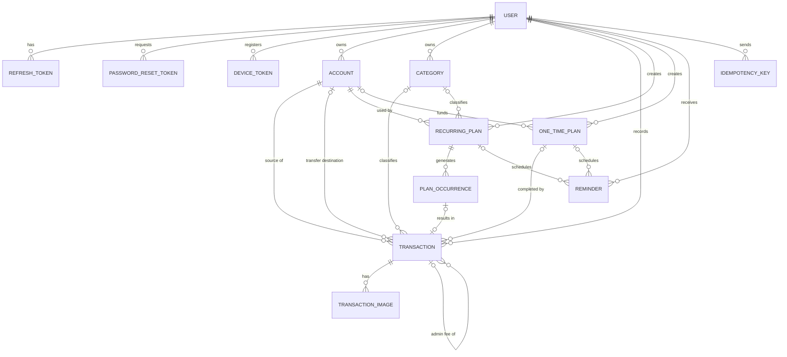

# PRD Financare: Entity Relationship Diagram (ERD)

Relational data model (PostgreSQL recommended). It extends the entity list in the main PRD with the additions required by [`user_flow.md`](./user_flow.md) and [`endpoint.md`](./endpoint.md).

## 1. Overview



## 2. Entities and Attributes

Conventions: primary keys are `uuid`; money is `bigint` (IDR, no decimals); timestamps are `timestamptz` stored in UTC; every table has `created_at` and `updated_at` unless noted. `PK` = primary key, `FK` = foreign key, `UK` = unique.

```mermaid
erDiagram
    USER {
        uuid id PK
        string name
        string email UK
        string password_hash
        string timezone "IANA, e.g. Asia/Makassar"
        boolean hide_balance "default false"
        time notif_send_time "default 08:00"
        time quiet_hours_start "nullable"
        time quiet_hours_end "nullable"
        boolean push_enabled "default true"
        boolean email_fallback "default false"
        timestamptz deleted_at "set while account deletion runs"
    }

    REFRESH_TOKEN {
        uuid id PK
        uuid user_id FK
        uuid family_id "one login session"
        string token_hash UK "SHA-256, never the raw token"
        string device_info
        timestamptz expires_at
        timestamptz revoked_at "nullable"
        uuid replaced_by "nullable, next token in rotation"
    }

    PASSWORD_RESET_TOKEN {
        uuid id PK
        uuid user_id FK
        string token_hash UK
        timestamptz expires_at "30 minutes"
        timestamptz used_at "nullable"
    }

    DEVICE_TOKEN {
        uuid id PK
        uuid user_id FK
        string token UK "FCM or APNs"
        enum platform "ANDROID, IOS"
        timestamptz last_seen_at
    }

    ACCOUNT {
        uuid id PK
        uuid user_id FK
        string name
        enum type "BANK, EWALLET, CASH"
        string institution "nullable"
        bigint initial_balance "default 0"
        string last4 "nullable, 4 digits"
        string color "nullable"
        string icon "nullable"
        boolean include_in_total "default true"
        enum status "ACTIVE, ARCHIVED"
    }

    CATEGORY {
        uuid id PK
        uuid user_id FK
        string name
        enum type "INCOME, OUTCOME"
        string icon "nullable"
        boolean is_default "seeded at register"
        boolean is_fallback "the Other category, protected"
    }

    TRANSACTION {
        uuid id PK
        uuid user_id FK
        uuid account_id FK "source account"
        uuid to_account_id FK "nullable, TRANSFER only"
        uuid category_id FK "nullable"
        uuid parent_transaction_id FK "nullable, transfer admin fee"
        uuid recurring_plan_id FK "nullable"
        uuid one_time_plan_id FK "nullable"
        enum type "INCOME, OUTCOME, TRANSFER"
        string name "max 100"
        bigint amount "greater than 0"
        timestamptz date "not in the future"
        string location "nullable"
        text note "nullable"
        text_array tags
        enum source "MANUAL, AUTO"
        timestamptz deleted_at "nullable, soft delete"
    }

    TRANSACTION_IMAGE {
        uuid id PK
        uuid transaction_id FK
        string public_id UK "Cloudinary public_id"
        string mime_type "jpg, png, heic"
        int size "bytes, max 5 MB"
        smallint position "0 to 4"
    }

    RECURRING_PLAN {
        uuid id PK
        uuid user_id FK
        uuid account_id FK
        uuid category_id FK "nullable"
        string name
        enum type "INCOME, OUTCOME"
        bigint amount
        enum frequency "DAILY, WEEKLY, MONTHLY, YEARLY"
        date start_date "anchor for day-of-month"
        date end_date "nullable"
        int_array reminder_offsets "subset of 0,1,3,7"
        boolean auto_record "default false"
        date next_due_date
        enum status "ACTIVE, PAUSED, ENDED"
    }

    PLAN_OCCURRENCE {
        uuid id PK
        uuid recurring_plan_id FK
        date due_date
        enum outcome "CONFIRMED, SKIPPED, AUTO_RECORDED"
        uuid transaction_id FK "nullable, null when SKIPPED"
        timestamptz resolved_at
    }

    ONE_TIME_PLAN {
        uuid id PK
        uuid user_id FK
        uuid source_account_id FK "nullable"
        string name
        date date
        bigint target_amount
        string location "nullable"
        text note "nullable"
        int_array reminder_offsets "subset of 1,3,7,14"
        enum status "PLANNED, DONE, MISSED, CANCELLED"
    }

    REMINDER {
        uuid id PK
        uuid user_id FK
        uuid recurring_plan_id FK "nullable"
        uuid one_time_plan_id FK "nullable"
        date due_date
        timestamptz scheduled_at
        timestamptz sent_at "nullable"
        enum channel "PUSH, EMAIL"
        enum status "SCHEDULED, SENT, ACTED, SNOOZED, SKIPPED, FAILED"
        int attempts "retry counter"
    }

    IDEMPOTENCY_KEY {
        uuid key PK
        uuid user_id FK
        string route
        jsonb response
        timestamptz created_at "purged after 24 hours"
    }
```



## 3. Relationships

| Relationship | Cardinality | Notes |
|---|---|---|
| User → Account | 1 : N | Every account belongs to exactly one user |
| User → Category | 1 : N | Default categories are copied per user at register |
| Account → Transaction (`account_id`) | 1 : N | Required. For a transfer this is the source account |
| Account → Transaction (`to_account_id`) | 1 : N (optional) | Only for `TRANSFER` |
| Category → Transaction | 1 : N (optional) | Not used for transfers. On category delete, transactions move to the fallback category |
| Transaction → TransactionImage | 1 : N | Maximum 5 per transaction |
| Transaction → Transaction (`parent_transaction_id`) | 1 : N (optional) | Admin fee outcome linked to its transfer |
| Transaction → plan | N : 0..1 | At most one of `recurring_plan_id` or `one_time_plan_id` is set |
| RecurringPlan → PlanOccurrence | 1 : N | One row per resolved due date |
| PlanOccurrence → Transaction | 1 : 0..1 | Null when the occurrence was skipped |
| Account → RecurringPlan | 1 : N | |
| Account → OneTimePlan (`source_account_id`) | 1 : N (optional) | Null means funding is checked against total balance |
| Plan → Reminder | 1 : N | A reminder belongs to exactly one plan (recurring or one-time) |
| User → RefreshToken / DeviceToken / PasswordResetToken / IdempotencyKey | 1 : N | |

## 4. Constraints

**Checks**
| Table | Constraint |
|---|---|
| `transaction` | `amount > 0` |
| `transaction` | `type = 'TRANSFER'` ⇔ `to_account_id IS NOT NULL`; `account_id <> to_account_id` |
| `transaction` | `type = 'TRANSFER'` ⇒ `category_id IS NULL` |
| `transaction` | `NOT (recurring_plan_id IS NOT NULL AND one_time_plan_id IS NOT NULL)` |
| `transaction` | `parent_transaction_id` is only allowed with `type = 'OUTCOME'`, and the parent must be a `TRANSFER` |
| `account` | `last4 ~ '^[0-9]{4}$'` when not null |
| `recurring_plan` | `amount > 0`; `end_date IS NULL OR end_date > start_date`; `reminder_offsets <@ {0,1,3,7}` |
| `one_time_plan` | `target_amount > 0`; `reminder_offsets <@ {1,3,7,14}` |
| `reminder` | Exactly one of `recurring_plan_id` and `one_time_plan_id` is not null |
| `transaction_image` | `position BETWEEN 0 AND 4` |

**Unique**
| Table | Columns | Purpose |
|---|---|---|
| `user` | `lower(email)` | One account per email |
| `plan_occurrence` | `(recurring_plan_id, due_date)` | **Idempotent** confirm, skip, and auto-record. A second attempt for the same due date fails and returns the existing result |
| `category` | `(user_id, type, lower(name))` | No duplicate category names |
| `transaction_image` | `public_id` | One Cloudinary asset is attached once |
| `refresh_token` | `token_hash` | |
| `device_token` | `token` | Re-registering the same token updates the row |
| `idempotency_key` | `(user_id, key)` | |
| `transaction_image` | `(transaction_id, position)` | |

**Application-level rules** (not expressible as simple checks)
- Maximum 5 images per transaction.
- `transaction.date` must not be later than now; future events are modeled as plans.
- Source and destination accounts must be `ACTIVE` when a transaction is created.
- A category's `type` must match the transaction's `type`.
- The fallback category ("Other") exists once per `type` per user and cannot be renamed or deleted.

## 5. Indexes

| Table | Index | Used for |
|---|---|---|
| `transaction` | `(user_id, date DESC) WHERE deleted_at IS NULL` | Transaction list, dashboard recent items |
| `transaction` | `(account_id, date DESC) WHERE deleted_at IS NULL` | Account balance and account history |
| `transaction` | `(to_account_id) WHERE to_account_id IS NOT NULL` | Incoming transfers |
| `transaction` | `(user_id, category_id, date)` | Outcome-by-category report |
| `transaction` | `(deleted_at) WHERE deleted_at IS NOT NULL` | Trash list and the 30-day purge job |
| `transaction` | GIN on `tags`; trigram on `name`, `note` | Search and tag filter |
| `recurring_plan` | `(status, next_due_date)` | Auto-record job |
| `one_time_plan` | `(status, date)` | Mark-missed job |
| `reminder` | `(status, scheduled_at)` | Sender job (polls every minute) |
| `reminder` | `(user_id, status)` | "Action needed" list |
| `refresh_token` | `(user_id)`, `(family_id)` | Revoke all or revoke a session family |
| `refresh_token` | `(expires_at)` | Cleanup job |

## 6. Balance Calculation

Balances are computed from transactions, not stored as the source of truth.

```sql
SELECT a.id,
       a.initial_balance
     + COALESCE(SUM(CASE WHEN t.account_id = a.id AND t.type = 'INCOME'   THEN t.amount END), 0)
     - COALESCE(SUM(CASE WHEN t.account_id = a.id AND t.type = 'OUTCOME'  THEN t.amount END), 0)
     - COALESCE(SUM(CASE WHEN t.account_id = a.id AND t.type = 'TRANSFER' THEN t.amount END), 0)
     + COALESCE(SUM(CASE WHEN t.to_account_id = a.id AND t.type = 'TRANSFER' THEN t.amount END), 0)
       AS current_balance
FROM account a
LEFT JOIN "transaction" t
  ON (t.account_id = a.id OR t.to_account_id = a.id) AND t.deleted_at IS NULL
WHERE a.user_id = :user_id
GROUP BY a.id;
```

- Soft-deleted transactions (`deleted_at` set) are excluded, so deleting a transaction restores the balance immediately and restoring it applies it again.
- A transfer's admin fee is a separate `OUTCOME` row linked by `parent_transaction_id`, so it reduces the source balance through the normal outcome path.
- `total_balance` sums `current_balance` of accounts with `status = 'ACTIVE'` and `include_in_total = true`.
- Optionally, a cached `balance` column can be kept for speed, updated in the same database transaction as every write. A periodic consistency job compares it against the query above.

## 7. Deletion and Retention Rules

| Action | Effect on data |
|---|---|
| Delete transaction | Sets `deleted_at` (also on its linked admin fee). Permanently deleted after 30 days, including Cloudinary images |
| Delete account | Allowed only when it has no transactions, including trashed ones; otherwise archive it |
| Archive account | `status = 'ARCHIVED'`. History stays, balance leaves the total |
| Delete recurring plan | `transaction.recurring_plan_id` set to null (`ON DELETE SET NULL`); `plan_occurrence` and `reminder` rows are removed |
| Delete one-time plan | `transaction.one_time_plan_id` set to null; its reminders are removed |
| Delete category | Transactions are re-pointed to the fallback category in the same database transaction, then the category row is deleted |
| Delete user | All user-owned rows removed (`ON DELETE CASCADE` from `user`), then Cloudinary folder `financare/<user_id>/` is deleted by a background job |
| Expired tokens | `refresh_token`, `password_reset_token`, and `idempotency_key` rows are purged by a daily job |

## 8. Changes Compared with the Main PRD Model

| Change | Reason |
|---|---|
| `TransactionImage.storage_key` replaced by `public_id` | Images are stored in Cloudinary |
| `Transaction.plan_id` split into `recurring_plan_id` and `one_time_plan_id` | Two plan tables; a single foreign key cannot reference both |
| `Transaction` adds `parent_transaction_id`, `source`, `tags` | Transfer admin fee, auto-recorded marker, tag search |
| New `PlanOccurrence` | Idempotent confirm, skip, and auto-record per due date |
| `Reminder` adds `due_date`, `attempts`; plan reference split in two | Retry handling and per-occurrence reminders |
| `Category` adds `is_default`, `is_fallback` | Seeded categories and the protected "Other" category |
| `User` adds `hide_balance` and notification preference columns | Hide-balance feature and notification settings |
| New `RefreshToken`, `PasswordResetToken`, `DeviceToken`, `IdempotencyKey` | JWT refresh rotation, password reset, push delivery, safe request retries |
| `RecurringPlan.offset_pengingat` → `reminder_offsets` (array); `OneTimePlan` likewise | A plan may have several reminder offsets |
