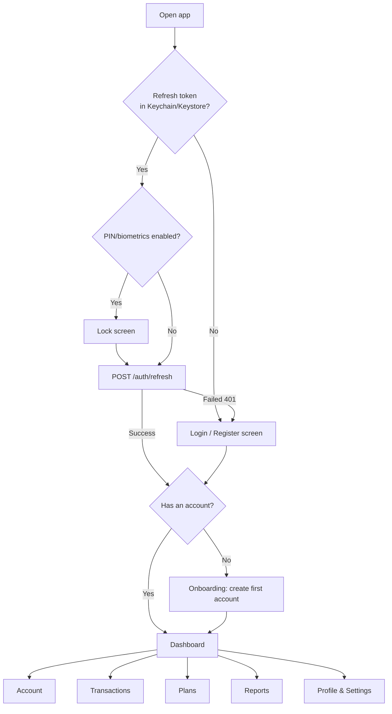
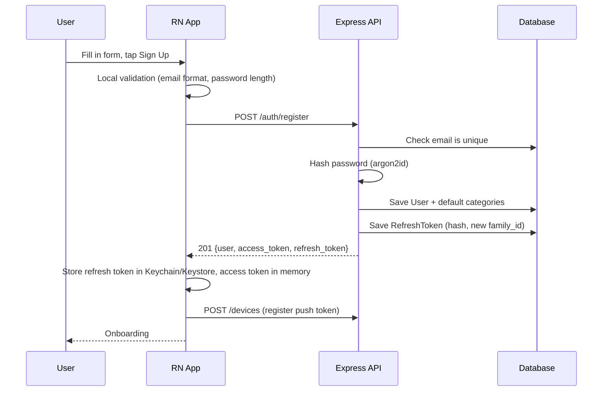
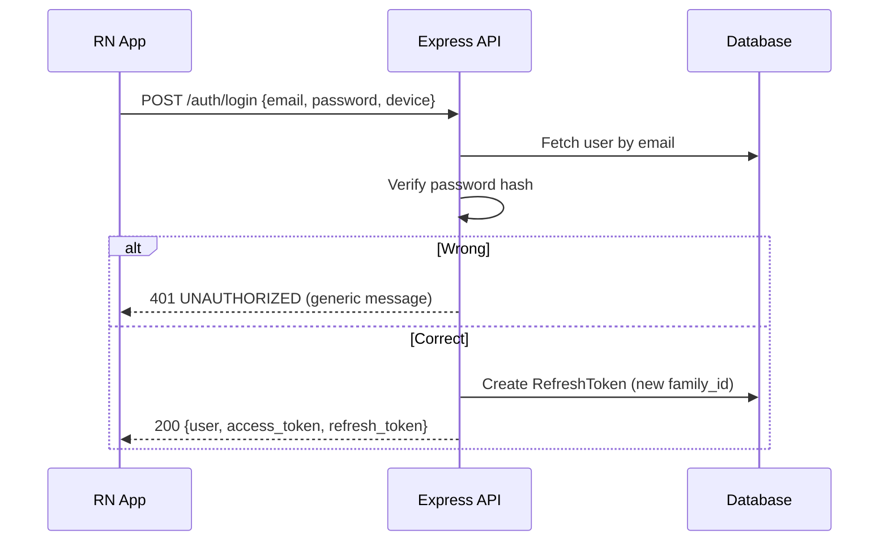
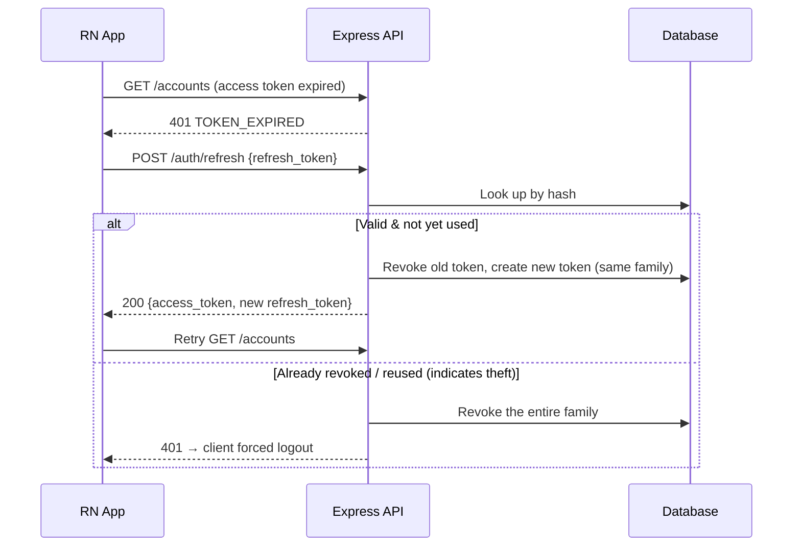
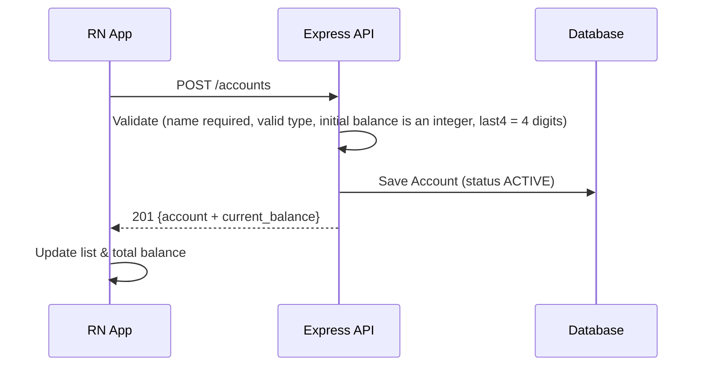
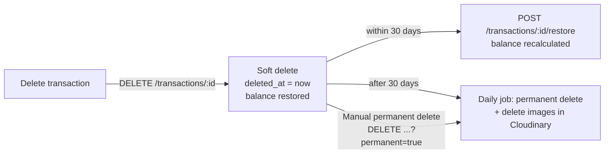
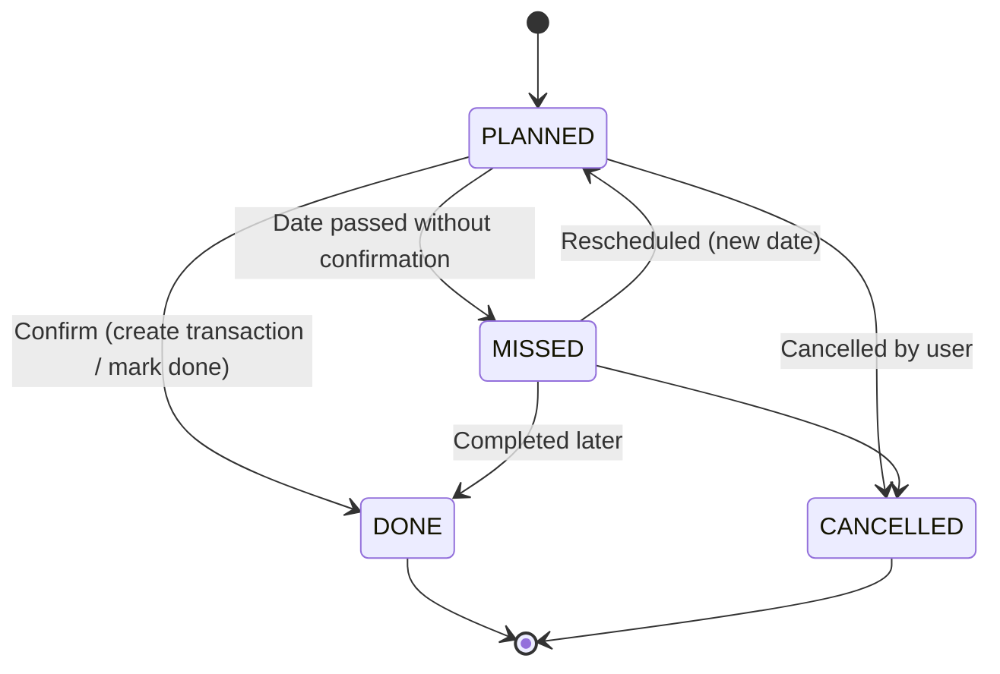
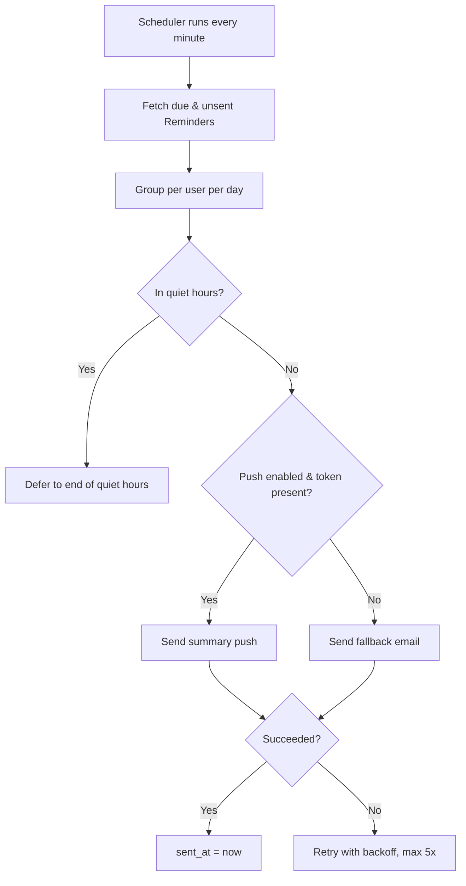
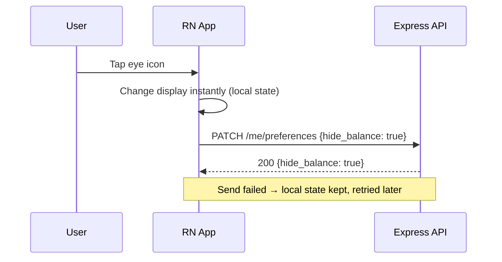

# PRD Financare: User Flow & Request/Response Flow

Companion document to the main PRD. It covers the user flow for each feature, along with the request and response flow between the app (React Native), the API (Express), the database, Cloudinary, and the push services (FCM/APNs).

## 0. API Conventions

The conventions (response format, error codes, authentication, pagination, idempotency) and the full specification of every endpoint are in [`endpoint.md`](./endpoint.md). This document only contains the flows and example requests/responses per scenario.

---

## 1. Main Screen Map



---

## 2. Authentication

Method: JWT access token (15 minutes) + opaque refresh token (30 days, rotated). The refresh token hash is stored in the `RefreshToken` table; the original value is never stored.

### 2.1 Register

**User flow**
1. Open the Register screen and fill in name, email, password (min. 8 characters), and password confirmation.
2. Tap "Sign Up".
3. Success: the user is signed in immediately and taken to onboarding (create first account).
4. Failure: a message appears under the relevant field (email already in use, weak password).



**Request**
```http
POST /api/v1/auth/register
{
  "name": "Apri",
  "email": "apri@mail.com",
  "password": "rahasia123",
  "timezone": "Asia/Makassar",
  "device": { "platform": "ANDROID", "name": "Pixel 7" }
}
```

**Response 201**
```json
{
  "data": {
    "user": { "id": "u1", "name": "Apri", "email": "apri@mail.com", "timezone": "Asia/Makassar" },
    "access_token": "eyJhbGciOi...",
    "access_expires_in": 900,
    "refresh_token": "rt_9f3c...opaque"
  }
}
```

**Rules**
- Email is stored in lowercase and must be unique. Duplicate: `409 CONFLICT`.
- Default categories are created at registration (Food, Transport, Bills, Shopping, Entertainment, Health, Salary, Other).
- Rate limit: 5 attempts/minute per IP.
- Email verification is deferred (post-MVP): the user can use the app right after registering.

### 2.2 Login



- Generic error message ("Incorrect email or password"), which does not distinguish between a nonexistent email and a wrong password.
- 5 consecutive failures within 15 minutes: `429 RATE_LIMITED`, the user is asked to wait.
- The response is the same as for register.

### 2.3 Refresh token (automatic, invisible to the user)



**Client rules**
- Only one refresh process runs at a time; other requests wait for its result.
- Refresh failed: delete local tokens and return to the Login screen with the message "Session expired, please sign in again".

### 2.4 Logout

- `POST /auth/logout {refresh_token}`: revokes this device's session. Responds `204`.
- `POST /auth/logout-all`: revokes all of the user's sessions (also used after a password change).
- The client deletes local tokens and sends `DELETE /devices/:id` so the device no longer receives push notifications.

### 2.5 Forgot & reset password

1. Login screen: "Forgot password" → enter email → `POST /auth/forgot-password {email}`. Always responds `202` (does not reveal whether the email is registered).
2. The server sends an email containing a one-time link/code (valid for 30 minutes).
3. The user enters the code and a new password → `POST /auth/reset-password {token, new_password}`.
4. The server updates the hash and revokes all of the user's refresh tokens. The user signs in again.

### 2.6 App lock (PIN/biometrics)

A device-local feature that does not call the API. Configured in Settings. When the app is opened or returns from the background (> 1 minute), the lock screen appears before any data is shown. After 5 failures: the user is asked to sign in again with their password.

---

## 3. Onboarding & Profile

1. After registering, the "Create your first account" screen (see 4.1), with a Skip option.
2. Notification permission prompt (required for reminders). If denied, the user is offered email as a fallback (`PATCH /me/notification-preferences { "email_fallback": true }`).
3. The location permission prompt only appears the first time the user taps "Auto-fill location" in the transaction form, not during onboarding.

**Profile**
- `GET /me`, `PATCH /me` (name, timezone).
- `PATCH /me/notification-preferences`: send time (default `08:00`), quiet hours, push/email channels.
- `PATCH /me/preferences { "hide_balance": true }`: hide balances (see 9.3). `GET /me` includes this value.
- `DELETE /me` with password confirmation: deletes all data and images in Cloudinary (see 11).

---

## 4. Account

### 4.1 Creating an account

**User flow:** Account tab → "+ Account" → fill in name, type (Bank/E-wallet/Cash), institution (optional, empty for Cash), initial balance (default 0), last 4 digits (optional), color/icon, "Include in total balance" toggle → Save.



**Request**
```http
POST /api/v1/accounts
{
  "name": "BCA Salary",
  "type": "BANK",
  "institution": "BCA",
  "initial_balance": 2500000,
  "last4": "1234",
  "color": "#1E88E5",
  "icon": "bank",
  "include_in_total": true
}
```

**Response 201**
```json
{ "data": { "id": "a1", "name": "BCA Salary", "type": "BANK", "institution": "BCA", "initial_balance": 2500000, "current_balance": 2500000, "last4": "1234", "include_in_total": true, "status": "ACTIVE" } }
```

### 4.2 Viewing accounts

- `GET /accounts?status=ACTIVE` returns the list with each account's `current_balance` and `total_balance` (only active accounts with `include_in_total = true`).
- `GET /accounts/:id` returns account details; its transaction history is available via `GET /transactions?account_id=:id`.
- `current_balance` is computed from transactions (not just a stored number): `initial_balance + income − outcome + incoming transfers − outgoing transfers`.

### 4.3 Editing an account

`PATCH /accounts/:id`. If `initial_balance` is changed and the account already has transactions:
1. The server responds `422` with `code: "CONFIRMATION_REQUIRED"` and `preview: { old_balance, new_balance }`.
2. The app shows a confirmation dialog: "Current balance will change from Rp3,000,000 to Rp3,500,000. Continue?"
3. The user agrees: the app resends the request with `"confirm": true`.

### 4.4 Archiving / deleting

- `POST /accounts/:id/archive`: the balance is removed from the total, history remains, and the account no longer appears in the choices for new transactions. Active plans that use this account are shown with a "needs a different account" warning and their reminders keep running.
- `POST /accounts/:id/unarchive`: reactivates it.
- `DELETE /accounts/:id`: only if the account has no transactions. Otherwise `422 BUSINESS_RULE` ("Account already has transactions, archive it instead").

### 4.5 Categories

- `GET/POST /categories`, `PATCH /categories/:id`. Default categories are created at registration; users can add their own categories (name, type INCOME/OUTCOME, icon).
- `DELETE /categories/:id`: transactions using that category are automatically moved to the "Other" category (matching the type), then the category is deleted. The app shows a confirmation: "12 transactions will be moved to Other."
- The "Other" category (INCOME and OUTCOME) cannot be deleted or renamed.
- The move and the deletion happen in a single database transaction.

---

## 5. Transactions

### 5.1 Recording a transaction (income/outcome) with a receipt photo

Target: complete in ≤ 30 seconds.

**User flow:** Dashboard "+ Transaction" → choose type (Income/Outcome) → amount → name → account (default: last used account) → category (optional) → date (default today) → location (type or "Auto-fill") → photo (camera/gallery, max 5) → Save.

```mermaid
sequenceDiagram
    participant U as User
    participant App as RN App
    participant API as Express API
    participant CLD as Cloudinary
    participant DB as Database
    U->>App: Take receipt photo
    App->>App: Compress (max ~1600px, quality 0.7), check size ≤ 5 MB
    App->>API: POST /uploads/sign {count}
    API-->>App: {cloud_name, api_key, timestamp, signature, folder, type: authenticated}
    App->>CLD: POST upload (file + signature)
    CLD-->>App: {public_id, bytes, format}
    U->>App: Tap Save
    App->>API: POST /transactions {..., images: [{public_id, mime_type, size}]}
    API->>API: Validate + check account belongs to user, is active, date ≤ today, images ≤ 5
    API->>DB: BEGIN; save Transaction + TransactionImage; COMMIT
    API-->>App: 201 {transaction, account_balance_after, warnings[]}
    App-->>U: Toast "Saved", balance updated
```

**Request**
```http
POST /api/v1/transactions
Idempotency-Key: 6c1b...
{
  "type": "OUTCOME",
  "name": "Monthly groceries",
  "amount": 450000,
  "date": "2026-11-13T03:20:00Z",
  "account_id": "a2",
  "category_id": "c1",
  "location": "Indomaret Sanur",
  "note": "Soap, rice",
  "tags": ["monthly"],
  "plan_id": null,
  "images": [{ "public_id": "financare/u1/abc123", "mime_type": "image/jpeg", "size": 812345 }]
}
```

**Response 201**
```json
{
  "data": {
    "transaction": { "id": "t1", "type": "OUTCOME", "name": "Monthly groceries", "amount": 450000, "account_id": "a2", "images": [{ "id": "i1", "url": "https://res.cloudinary.com/.../s--sig--/..." }] },
    "account_balance_after": 350000,
    "warnings": []
  }
}
```

**Rules & edge cases**
| Situation | Behavior |
|---|---|
| Amount ≤ 0 or not an integer | `400 VALIDATION_ERROR` |
| Future date | `422 BUSINESS_RULE` + suggestion: "Create a One-Time Plan" (button goes straight to the plan form) |
| Outcome exceeds balance | Still saved (`201`), `warnings: [{ "code": "NEGATIVE_BALANCE", "balance_after": -150000 }]`; the app shows a warning and the balance is marked negative |
| Account is archived | `422 BUSINESS_RULE` |
| More than 5 images | `422 BUSINESS_RULE`. The client also limits this in the UI |
| Image upload fails | The transaction can still be saved without images; images can be added later (5.4) |
| Request resent (network dropped) | The same `Idempotency-Key` returns the original result, not a duplicate transaction |
| When creating a transaction and the balance changes | Happens in a single database transaction |

### 5.2 Transfer between accounts

**User flow:** "+ Transaction" → Transfer tab → source account, destination account, amount, admin fee (optional), date → Save.

```http
POST /api/v1/transactions
{
  "type": "TRANSFER",
  "name": "GoPay top-up",
  "amount": 200000,
  "admin_fee": 1000,
  "date": "2026-11-13T04:00:00Z",
  "account_id": "a1",
  "to_account_id": "a2"
}
```

- Source and destination must not be the same (`400`).
- The source balance decreases by `amount + admin_fee`, the destination balance increases by `amount`.
- The admin fee is recorded as a separate outcome in the "Admin Fee" category so it appears in reports. The transfer itself is not counted as income/outcome in reports.
- The response includes both accounts' balances after the transaction.

**Usage examples by account type**
| Case | Source → Destination | Notes |
|---|---|---|
| ATM cash withdrawal | BRI → Cash | ATM admin fee optional |
| Cash deposit | Cash → BRI | |
| E-wallet top-up | BRI → GoPay | Admin fee is often present |
| Move between bank accounts | BRI → BCA | |

The form has a swap button (⇄) to reverse the source and destination. The destination choices do not show the same account as the source, and only show active accounts. The app provides "Withdraw cash" / "Deposit cash" shortcuts that automatically fill in the transfer name and account types.

**Additional rules**
- Insufficient source balance: can still be saved with a warning, same as outcome (the source balance becomes negative).
- Future dates are rejected, same as other transactions.
- The admin fee is stored as a separate outcome transaction linked to the transfer via `parent_transaction_id`. Because they are linked, editing or deleting the transfer also edits or deletes its admin fee, in a single database transaction.
- Editing a transfer (amount, date, source, or destination) recalculates the balances of all affected accounts, including the old account.
- Deleting a transfer goes to the 30-day trash like other transactions; both the source and destination balances are restored, and restoring recalculates them again.
- In the transaction list, a transfer appears as a single row ("BRI → Cash, Rp500,000"), with its own label. Transfers are not counted as income/outcome in summaries and reports, and do not change the total balance (unless one of the accounts is not included in the total).
- The `account_id` filter on the transaction list shows a transfer if that account is either the source or the destination.

### 5.3 Viewing & searching transactions

`GET /transactions?from=2026-11-01&to=2026-11-30&type=OUTCOME&account_id=a2&category_id=c1&q=groceries&cursor=...&limit=20`

- Sorted by date descending, grouped by day on the client with subtotals.
- The `q` search matches name and note.
- Tap an item → details: all fields, image gallery (tap for full screen, signed URLs with a short expiry; if expired the client requests a fresh one via `GET /transactions/:id`).

### 5.4 Editing a transaction

`PATCH /transactions/:id`. Changing the amount, type, date, or account recalculates the balances of both accounts (old and new) in a single database transaction.

Images:
- Add: repeat the sign → Cloudinary upload flow → `POST /transactions/:id/images {public_id, mime_type, size}` (check total ≤ 5).
- Delete: `DELETE /transactions/:id/images/:imageId` → delete the record and call Cloudinary destroy.
- Order: `PATCH /transactions/:id/images/order {ids: [...]}`.

### 5.5 Deleting & restoring transactions



- `GET /transactions/trash` shows the contents of the trash.
- Deleting a transaction created from a plan: the related plan does not automatically change status; the user is offered "Return plan to not completed".

---

## 6. Recurring Plans

### 6.1 Creating a recurring plan

**User flow:** Plans tab → "+ Plan" → Recurring → fill in name, type, amount, account, frequency (Daily/Weekly/Monthly/Yearly), start date, end date (optional), reminders (on the day/1 day before/3 days before/7 days before), "Auto-record" toggle (default off) → Save.

```http
POST /api/v1/recurring-plans
{
  "name": "Gym",
  "type": "OUTCOME",
  "amount": 350000,
  "account_id": "a2",
  "frequency": "MONTHLY",
  "start_date": "2026-12-01",
  "end_date": null,
  "reminder_offsets": [1, 0],
  "auto_record": false
}
```

**Response 201**
```json
{ "data": { "id": "rp1", "name": "Gym", "status": "ACTIVE", "next_due_date": "2026-12-01", "reminder_offsets": [1, 0], "auto_record": false } }
```

**Rules**
- `next_due_date` = `start_date` initially.
- Monthly frequency with dates 29–31: in shorter months it falls on the last day of that month. The original date from `start_date` is kept as the reference (so Jan 31 → Feb 28 → Mar 31).
- The start date may be today or in the future.
- The server schedules a `Reminder` for the next due date according to `reminder_offsets`.
- `auto_record = true` is only allowed for fixed types and amounts; the UI shows a note "Transaction is created automatically on the due date".

### 6.2 Reminders and confirmation

```mermaid
sequenceDiagram
    participant Job as Scheduler (server)
    participant DB as Database
    participant Push as FCM/APNs
    participant App as RN App
    participant API as Express API
    Job->>DB: Fetch due Reminders (scheduled_at ≤ now, sent_at null)
    Job->>Push: Send notification (combined if >1 on the same day)
    Job->>DB: Mark sent_at (failed → retry)
    Push-->>App: "Gym Rp350,000 is due tomorrow"
    App->>API: User taps → GET /recurring-plans/rp1
    App->>API: POST /recurring-plans/rp1/occurrences/2026-12-01/confirm {amount?, date?}
    API->>DB: BEGIN; create Transaction (plan_id, unique key plan+due_date); advance next_due_date; COMMIT
    API-->>App: 201 {transaction, next_due_date}
```

**User choices on the reminder screen**
| Action | Endpoint | Result |
|---|---|---|
| "Already paid/received" | `POST /recurring-plans/:id/occurrences/:dueDate/confirm` | Creates a pre-filled transaction (name, type, amount, account). The user can change the amount/date before confirming. `next_due_date` advances |
| "Skip this period" | `POST /recurring-plans/:id/occurrences/:dueDate/skip` | No transaction; `next_due_date` advances |
| "Remind me later" | `POST /reminders/:id/snooze {minutes}` | The reminder is rescheduled |

- Duplicate confirmation for the same `plan + due_date`: `409 CONFLICT` with the existing transaction in the response (idempotent).
- Reminders that have not been acted on appear in the "Action needed" list on the dashboard.

### 6.3 Auto-record

```mermaid
sequenceDiagram
    participant Job as Scheduler (server)
    participant DB as Database
    participant Push as FCM/APNs
    Job->>DB: Find ACTIVE RecurringPlans, auto_record, next_due_date ≤ today (user's timezone)
    loop each plan
        Job->>DB: BEGIN; INSERT Transaction with unique(plan_id, due_date)
        alt Already exists (job triggered twice)
            DB-->>Job: Unique violation → skip
        else New
            Job->>DB: Advance next_due_date; COMMIT
            Job->>Push: "Gym Rp350,000 recorded automatically"
        end
    end
```

- Runs on the server even if the app is not opened.
- The transaction is labeled "Automatic" and can be edited/deleted as usual.
- If the account balance is insufficient, the transaction is still created (negative balance) and the notification includes a warning.
- If the account is archived, auto-record does not run; the user is sent an "Action needed" notification.

### 6.4 Managing recurring plans

- `GET /recurring-plans` lists plans plus `next_due_date`.
- `PATCH /recurring-plans/:id`: changing the amount/frequency applies to the following periods, not past transactions.
- `POST /recurring-plans/:id/pause` and `/resume`. When resumed, due dates missed during the pause are not backfilled; `next_due_date` is calculated to the next upcoming date.
- `DELETE /recurring-plans/:id`: transactions already created remain (`plan_id` becomes null).
- Passing `end_date`: the status automatically becomes completed and reminders stop.

---

## 7. One-Time Plans

### 7.1 Creating a plan

**User flow:** Plans tab → "+ Plan" → One-Time → name, date, funds to prepare, source account (optional), location, note, reminders (1/3/7/14 days before, more than one allowed) → Save.

```http
POST /api/v1/one-time-plans
{
  "name": "Black Friday Shopping",
  "date": "2026-12-12",
  "target_amount": 1500000,
  "source_account_id": "a1",
  "location": "Bali Galeria Mall",
  "note": "Shoes, bag",
  "reminder_offsets": [7, 3, 1]
}
```

**Response 201**
```json
{ "data": { "id": "op1", "status": "PLANNED", "target_amount": 1500000, "funding": { "available": 1200000, "shortfall": 300000, "sufficient": false } } }
```

- The date must be today or in the future.
- `funding` is calculated from the balance of `source_account_id`; if empty, from the total balance.
- The server schedules a `Reminder` for each offset that has not yet passed.

### 7.2 Reminders with funding sufficiency status

The notification content is calculated at send time (not when the plan is created) so the latest balance is used. If the user has enabled Hide balance (9.3), balance and shortfall figures are not shown, only the sufficient/insufficient status:

> "Prepare Rp1,500,000 for Black Friday Shopping (in 3 days). Your current BCA balance is Rp1,200,000, short by Rp300,000."

Tap the notification → plan details with funding progress (`available / target`) and a quick "Transfer to source account" button that opens the transfer form with the shortfall amount pre-filled.

### 7.3 On or after the plan date



The user chooses one of the following from the confirmation screen:
| Action | Endpoint | Result |
|---|---|---|
| Create outcome transaction | `POST /one-time-plans/:id/complete {amount, account_id, date, create_transaction: true}` | Creates a transaction (plan_id filled) in a single database transaction, status `DONE` |
| Mark done without a transaction | `POST /one-time-plans/:id/complete {create_transaction: false}` | Status `DONE` |
| Cancel | `POST /one-time-plans/:id/cancel` | Status `CANCELLED`, reminders stop |
| Reschedule | `PATCH /one-time-plans/:id {date}` | Back to `PLANNED`, reminders recalculated |

- A daily job marks `PLANNED` plans with a past date as `MISSED` and sends a single follow-up notification.

### 7.4 Managing

`GET /one-time-plans?status=PLANNED`, `PATCH`, `DELETE` (related transactions remain).

---

## 8. Notifications & Devices

### 8.1 Registering a device

- `POST /devices {platform: "ANDROID"|"IOS", push_token}` is called after login and whenever the token changes.
- Tokens rejected by FCM/APNs (invalid) are automatically deleted by the server.

### 8.2 Delivery



- Default time is 08:00 in the user's timezone; tolerance ± 5 minutes.
- Multiple reminders on the same day are combined into one summary notification, with a deep link to the "Action needed" list.
- The notification stores `reminder_id` so tapping it opens the correct screen.

---

## 9. Dashboard & Reports

### 9.1 Dashboard

`GET /dashboard` returns everything in a single call (target ≤ 2 seconds on 4G).

```json
{
  "data": {
    "total_balance": 3800000,
    "accounts": [{ "id": "a1", "name": "BCA Salary", "current_balance": 3000000 }],
    "month_summary": { "income": 8000000, "outcome": 4200000, "net": 3800000 },
    "recent_transactions": [],
    "upcoming_reminders": [{ "plan_type": "ONE_TIME", "plan_id": "op1", "name": "Black Friday Shopping", "due": "2026-12-12", "funding": { "sufficient": false, "shortfall": 300000 } }],
    "action_needed": []
  }
}
```

- Sections: total balance + balance per account, current month summary, last 5 transactions, reminders for the next 7 days (recurring and one-time), the "Action needed" list, and the "+ Transaction" button.
- Pull-to-refresh calls this endpoint again. Transfers are not included in the income/outcome summary.

### 9.2 Basic reports

| Report | Endpoint |
|---|---|
| Spending by category | `GET /reports/outcome-by-category?from&to` |
| Monthly income/outcome trend | `GET /reports/monthly-trend?months=6` |
| Cash flow per account | `GET /reports/account-flow?from&to` |

### 9.3 Hide Balance

For users who do not want their balance to be immediately visible (for example when the app is opened in a public place).

**User flow**
1. On the dashboard, an eye icon sits next to the total balance. Tap to hide; tap again to show.
2. While hidden, amounts are displayed as `Rp ••••••`.
3. The option is also available in Settings → Privacy → "Hide balance".
4. The choice is remembered: when the app is opened again, the state stays hidden.



**Request / Response**
```http
PATCH /api/v1/me/preferences
{ "hide_balance": true }
```
```json
{ "data": { "hide_balance": true } }
```

**What is hidden**
| Where | Behavior when hidden |
|---|---|
| Total balance on the dashboard | `Rp ••••••` |
| Balance per account (dashboard, account list, account details, account picker in forms) | `Rp ••••••` |
| Balance after a transaction (`account_balance_after`) and negative balance warning | The warning still appears without the figure: "This account's balance is now negative" |
| Funding sufficiency in one-time plans | Only the status "Funds sufficient" / "Funds insufficient"; balance and shortfall figures are hidden |
| Push and email notifications | No balance figures (see below) |

**What is not hidden:** transaction amounts, plan amounts, and the monthly income/outcome summary, since they are not balances. (See the open question in section 13.)

**Notifications**
The server reads `hide_balance` when composing the reminder content, because push notifications appear on the lock screen.

- Off: "Prepare Rp1,500,000 for Black Friday Shopping (in 3 days). Your current BCA balance is Rp1,200,000, short by Rp300,000."
- On: "Prepare Rp1,500,000 for Black Friday Shopping (in 3 days). Funds in BCA are not yet sufficient."

**Technical notes**
- Hiding is done on the client. The API still returns balance data so that calculations and status changes are instant; only the way it is displayed and the notification content differ.
- A single balance display component is used (`<Money value hideable />`) so this rule is consistent on every screen.
- The value is stored on the server (synced across devices) and in local storage (so it is hidden immediately when the app opens, before the API response arrives).
- Also hidden in the app preview in the app switcher and in screenshots, if the "Protect screen" option is enabled (optional).
- Default: off.

---

## 10. Handling Special Conditions on the Client

| Condition | Behavior |
|---|---|
| No connection | Reads show the message "No connection" (full offline mode is deferred to phase 2). The save button shows a retryable error; form data is not lost |
| Timeout / 5xx | Retry with backoff for GET; for POST use the same `Idempotency-Key` |
| 401 `TOKEN_EXPIRED` | Automatic refresh flow (2.3) |
| Refresh failed | Forced logout + session expired message |
| Camera/location/notification permission denied | The related feature is disabled with an explanation and a link to system settings |
| Device timezone changes | The app offers to update the profile `timezone` so reminder times stay correct |

---

## 11. Deleting an Account

1. Profile → "Delete account" → warning that all data and photos will be permanently deleted → enter password.
2. `DELETE /me {password}` → `202 Accepted`.
3. The server revokes all tokens, then a background job deletes all of the user's data (transactions, plans, accounts, devices) and calls Cloudinary `delete_resources_by_prefix("financare/<user_id>/")`.
4. The client deletes local tokens and returns to the Login screen.

---

## 12. Endpoint Summary

The complete list of endpoints, fields, validation rules, and error codes is in [`endpoint.md`](./endpoint.md).

---

## 13. Product Decisions

| # | Question | Decision |
|---|---|---|
| 1 | Email verification at registration | Deferred (post-MVP). Password reset stays in the MVP |
| 2 | Deleting a category that is already in use | Transactions are moved to the "Other" category (see 4.5) |
| 3 | Plan and image limits | The number of plans is not limited in the MVP. Images are capped at 5 per transaction, with no total limit per user |
| 4 | Auto-record when balance is insufficient | Still recorded, with a warning in the notification |
| 5 | Scope of Hide balance | Balances only. Transaction amounts and the income/outcome summary remain visible |
| 6 | Verification when showing the balance | Not needed, just tap the eye icon |

Still open (technical): scheduler hosting, database, repo structure, and Expo vs. bare React Native.
